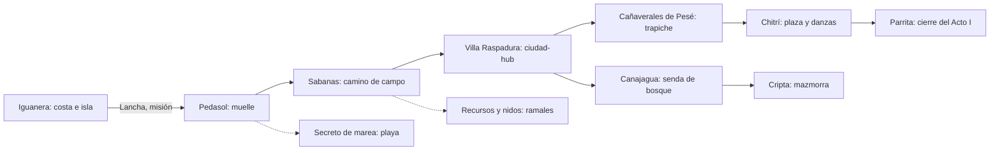

# FrankmanGames — Atlas territorial, bestiario por familias y planificación vial (propuesta v1)

**Fecha de revisión:** 20 de noviembre de 2026  
**Commit de referencia para datos del mundo:** `fc12760be8401976dca1a053cf398305c70076ee` (`master`, 20-11-2026). **Actualización de seguimiento:** durante la revisión avanzó hasta `b80e56972a69` (JL-34, limpieza de logs); no se observaron cambios adicionales de diseño territorial en esos dos commits.  
**Estado:** **PROPUESTA / INVESTIGACIÓN**. No implementar ni mover el contenido del mundo sin la aprobación del creador.  
**Principio creativo:** Panamá inspira la **geografía, biodiversidad, memoria histórica y vida cotidiana**; FrankmanGames añade ficción, humor y criaturas originales. No es un simulador turístico ni un mapa histórico literal.

> **Nota del coordinador (2026-11-20, noche).** Auditoría externa que trajo el creador. Las tareas que salen de ella son MAP-GEO-01, MAP-VIAL-01/02, BES-02, REF-01 y CUL-01 en [TAREAS](../TAREAS.md#nuevas-del-coordinador-2026-11-20-noche-atlas-caminos-y-bestiario-territorial). Contrastada con `54a6b26`, corrige lo siguiente:
> - **Arquetipos.** Hay 72 (69 más los tres de cripta de JL-44). 68 usan uno de los cinco modelos genéricos. El cangrejo propio (OMP-FA-01) existe, pero todavía no está enlazado en `data/assets.json`; eso es JL-45.
> - **Punto 3 de las alertas.** Chame, Boquete, Cerro Punta y Barú no tienen áreas en el mapa (`areas: []`): son «datos sin mapa». El desorden real está en las zonas de Herrera que heredan con `extends` los monstruos de otra región:
>   - Cañaverales de Pesé ← Chame: cangrejos y caimanes de manglar entre caña.
>   - Parrita ← Boquete: quetzales y recolectores de café.
>   - Ocú ← Barú: jaguares y yetis.
>   - Las Macanas ← Darién: arpías y tapires.
>   - Sarigua ← Bocas: piratas, sirenas y la rana dorada.
> - **Colas.** JL-41…47 están hechas, salvo JL-45. OMP-FA-01 está hecha.
> - **Mapas reales.** OpenStreetMap (ODbL), ANATI y MiAmbiente se consultan solo como referencia visual. No se importan sus datos al repositorio.

## 1. Hallazgos contrastados con el código

| Componente | Estado comprobado | Acción recomendada |
|---|---|---|
| `data/panama.json` | Atlas de 15 regiones: 10 provincias, 3 comarcas y los dos países limítrofes. Contiene nombres ficticios, biomas, fauna en texto, puntos y límites. Escala: `metersPerKm: 10` (1 km real → 10 m de juego). | Conservar. Completar una capa territorial de contenido y una red vial lógica. |
| `src/world/atlas.ts` | Proyección geográfica, consulta de provincia, costa, topografía real comprimida y relieve estilizado. | **Reutilizar**, no crear otro atlas. |
| `src/world/stream.ts` | Gestión de páginas/sectores de mundo. | Seguir su contrato; no reconstruir toda la transmisión de mundo para una tarea cartográfica. |
| `src/sim/paths.ts` | `PathDef = { width, points }`, geometría de caminos y distancia al borde. | Agregar, si se aprueba, **metadatos y conectividad fuera del render**. |
| `src/world/terrain.ts` y `data/terrain.json` | El terreno ya usa `PathDef` para aplanado/texturizado. | Generar geometría de caminos a partir de un grafo aprobado; mantener compatibilidad con caminos actuales. |
| `data/zones.json` | 24 zonas declaradas: 1–100, algunas seguras o especiales; campos `spawns`, `areas`, `levelMin`, `levelMax`, `group`. | No borrar ni recolocar sin plan de migración y guardados. |
| `data/rpg/enemies.json` | 69 enemigos; estadísticas y elementos, pero sin contrato común completo de familia, hábitat y jefatura. | Normalizar fichas en el catálogo de diseño y posteriormente en datos validados. |
| `docs/diseno/04_BESTIARIO.md` | Define 4–6 miembros por familia, mecánica firma, jefe, cultura y contrajuego. Todavía menciona 65 arquetipos. | **Actualizar a 69**; preservar sus ideas Tejelunas, Comejenes, Arrieras, Gusarapos, aves, leyendas y Compañía. |
| `docs/diseno/05_VERSION_ESTABLE.md` | Hito Acto I 1–40; primera rebanada 1–10 Iguanera–Pedasol–Sabanas. | Mantener ese foco; provincias nuevas son diseño futuro, no tareas de implementación simultánea. |
| `docs/TAREAS.md` | BES-01 autorizado (diseño bestiario), MOD-03 bloqueado por BES-01; OMP-FA-01…20 autorizadas; JL-41…47 de Compendio/visores/revisión asignadas. | No duplicar ni pisar estas colas. Coordinar aceptación por familia antes de producción masiva. |

### Corrección importante de nuestra interpretación inicial

No es cierto que el juego carezca de cartografía geográfica o streaming: **ambos existen**. Lo que falta es la **planificación estructural/vial, ecológica y narrativa de todo el territorio**, y su contrato como datos verificables. El atlas regional y las zonas jugables actuales son capas distintas; no deben confundirse.

### Inconsistencias y alertas confirmadas

1. `bocas_frog = "Rana Dorada Venenosa"`: la rana dorada panameña (*Atelopus zeteki*) se asocia históricamente a Coclé y Panamá Oeste, no a Bocas del Toro. Propuesta: en Bocas usar una **ranita roja fantástica de las islas** y reservar la dorada, como especie amenazada y símbolo de protección, para El Valle de Antón/Coclé. **No cambiar ID hoy.**
2. `docs/diseno/04_BESTIARIO.md` indica 65, pero `data/rpg/enemies.json` contiene 69 definiciones: deriva documental.
3. `data/zones.json` combina las primeras áreas de Azuero, Chame, Boquete, Cerro Punta y Barú a distancias que requieren contrastarse con las posiciones geográficas del atlas. Revisar puente entre zona jugable y localización territorial; **no interpretar automáticamente el orden del array como vecindad**.
4. `data/panama.json` muestra niveles tentativos por provincia (p. ej. Herrera 10–80 y Panamá 90–100). Una provincia real no necesita un único nivel: el desafío debe vincularse a hábitat, ruta y zona, no a todo su territorio.
5. Hay monstruos con nombres históricos/culturales. Verificar qué nombres son fantasía y cuáles expresiones reales; no presentar una criatura ficticia como representación fiel de una tradición viva.
6. Los modelos de OMP pueden existir sin usarse por el juego. Diferenciar estados `diseñado`, `modelado`, `validado`, `integrado`, `probado_en_Electron`.

---

## 2. Regla maestra territorial

**Provincia/comarca → subregión geográfica → bioma → zona jugable → caminos → asentamientos → hábitats → familias y jefes → misiones y recursos**.

Cada zona debe contener:

- Provincia o territorio de referencia, nombre ficticio visible y nombre real solo en las notas de diseño.
- Biomas predominantes y secundarios, clima, agua, elevación, cambios de temporada y flora característica.
- Origen y destino de vías, tipos de vía, puentes, barcas, entradas, atajos, regreso y conectividad segura.
- Centros de población, función del pueblo, oficios, comercio y arquitectura regional.
- 2–3 familias dominantes como regla general, con límite de densidad y encuentros especiales; evitar una mezcla de especies sin hábitat.
- Un hito visible, un secreto real, un conflicto narrativo, un recurso y una misión.
- Una mecánica territorial (marea, lodo, talud, viento, ruina, lluvia, elevación, etc.).
- Puestos de descanso y rutas alternativas; una región no se vuelve un corredor de enemigos obligatorio.
- Fuentes de investigación y estado de aprobación de arte, narrativa y balance.

### Escala y continuidad

El atlas usa `metersPerKm:10`; es un **mapa-miniatura**, no una réplica 1:1. Las principales conexiones espaciales deben respetar la **orientación y secuencia** de Panamá. Las sendas y los mapas jugables pueden curvarse o exagerarse por diversión, manteniendo nodos geográficos coherentes. Las islas se conectan mediante transporte de agua o aire, no con puentes inventados por comodidad. No unir directamente regiones distantes sin justificar un viaje de larga distancia.

---

## 3. Diez provincias — catálogo de diseño propuesto

> **Real / investigado:** provincia, paisaje y referencias de fauna/flora. **Ficción / propuesta:** nombres de monstruos, familias, comportamientos y jefes. Las afinidades elementales son candidatas; no implican cambios automáticos en `enemies.json`.

| Provincia / región ficticia | Subzonas y referencias reales | Flora / ambiente de referencia | Familias de monstruos propuestas | Jefe y combate característico |
|---|---|---|---|---|
| **Los Santos / Los Santicos** | Pedasí, Isla Iguana, Tonosí, Canajagua, sabanas | Bosque seco, corotú, árboles de potrero, palma, vegetación de costa | **Comejenales** (nidos), **Gallotes de Camino** (picada al herido), **Duendes de Cerca** (trampas/camuflaje) | **Comejenal Mayor**: rompe 3 bocas de nido; al romper cada una cambia el patrón de crías. **Doña Tejeluna** más adelante en Canajagua. |
| **Herrera / Herrerita** | Chitré, Parita, Pesé, Sarigua, Ocú | Sabanas secas, caña, guayacán/árboles de finca, albinas y ciénagas | **Arrieras** (filas), **Gusarapos Salitrosos** (subterráneos), **Diablicos del Compás** (ritmos y lectura) | **Chano del Compás**: telegráficos musicales y ventanas de interrupción; final del Acto I. |
| **Coclé / Coclá** | El Valle de Antón, Antón, Natá, Penonomé, El Copé | Montaña húmeda, bosque, orquídeas, helechos, guayacanes, cráter | **Custodios del Cráter**, **Ranas del Oro Soñado** (protectores, no zoología literal), **Barrocanteros** (arcilla animada) | **Campanero del Cráter**: alterna niebla y resonancias; el jugador desactiva altares y abre rutas. |
| **Panamá Oeste / Panamita Oeste** | Chame, Punta Chame, Campana, Capira | Manglar rojo/blanco/negro, raíces expuestas, barro intermareal y lomas | **Cangrejos Macheteros**, **Garzas Flecheras**, **Guardianes de Raíz** (mezcla ficticia cangrejo/mangle) | **Cangrejo Abuelo del Manglar**: marea cambia las rutas; corta raíces para abrir paso, no simple HP inflada. |
| **Veraguas / Veraguí** | Santiago, Santa Fe, Montijo, Coiba, Cerro Hoya | Bosque nuboso, selva, manglares, costas e islas | **Madrigueras de Hojarasca** (ñeques mágicos), **Corales Caminantes** (islas), **Náufragos del Presidio** (ficción histórica) | **El Faro Desvelado**: niebla/isla, faros y mareas; resolver rutas de navegación. |
| **Chiriquí / Chiricú** | Boquete, Volcán, Cerro Punta, Barú, David | Cafetales, bosque nuboso, musgo, bromelias, orquídeas, páramo volcánico | **Quetzales de Bruma**, **Raíces del Cafetal**, **Brasas de Altura** | **El Vigía del Barú**: controla corrientes ascendentes, roca y viento; enemigo de altura. |
| **Bocas del Toro / Bocas del Torito** | Isla Colón, Bastimentos, Almirante, Changuinola | Litoral caribeño, bosque húmedo, manglar, corales, bananeras | **Ranitas de Coral** (colores ficticios), **Aguamalas de Bruma**, **Marineros del Aguacero** | **Capitán Calipso**: agua, tormenta, movimientos del muelle; rutas de escape por plataformas. |
| **Colón / Colona** | Portobelo, San Lorenzo, Chagres, lago Gatún | Selva muy húmeda, costa caribeña, fortificaciones, ríos y lagos | **Cangrejos de Fortín**, **Centinelas Oxidados**, **Navegantes del Chagres** | **El Guardallaves de Portobelo**: defender/abrir portones y dividir la arena entre patios. |
| **Panamá / Panamita** | Panamá Viejo, Ancón, Chepo/Bayano, islas de las Perlas | Selva urbana, humedal litoral, bosque de canal, manglar y ruinas históricas | **Espejos Descompasados** (solo reflejos hostiles ficticios), **Diablos Rojos Encantados** (vehículos), **Ostras de Marea** | **La Espeja del Arco Viejo**: máscara/infiltración, espejos y falso reflejo. No convertir automáticamente a practicantes reales de danzas en villanos. |
| **Darién / Dariena** | Yaviza, La Palma, cuencas Tuira/Chucunaque, Cana, selvas | Selva tropical de alta diversidad, ríos, árboles gigantes y humedales | **Ñeques del Sendero**, **Guardianes de Ceiba**, **Sombras de Jaguar** (fantasía no caza), **Alas del Dosel** | **Centinela del Dosel**: corta puentes de lianas, invoca hojas, cambia altura; la harpía es aliada/transportista y no botín cazable. |

**Las comarcas indígenas no se reducen a familias enemigas ni se incorporan automáticamente a una provincia ficticia.** Mantener sus territorios en el atlas; para desarrollarlos investigar con comunidades portadoras y construir historias con personajes autónomos, no caricaturas ni «monstruos indígenas». El mismo criterio aplica a tradiciones de Corpus Christi, expresiones Congo y otras culturas vivas.

### Cruces creativos permitidos

Las especies reales son **semillas de diseño**, no limitaciones: cangrejo + raíces de mangle = guardián defensivo; termita + nido andante = invocador territorial; garza + aguja de bambú = tiradora de precisión; rana pequeña + burbuja de humedad = apoyo ambiental; quetzal + niebla = ave de ilusión; jaguar + sombra de ceiba = jefe de ocultación. Se preservan silueta, animación legible y contrajuego antes de aumentar daño o resistencia.

### Protección y representación

La rana dorada real (*Atelopus zeteki*) ha desaparecido del medio silvestre según MiAmbiente; **no usarla como enemigo genérico en Bocas**. Crear una misión de cuidado/investigación en Coclé y una ranita fantástica distinta para las islas caribeñas. La harpía real es ave nacional protegida: usarla como símbolo y aliada transportista, no como enemigo para farmear. Los animales reales pueden inspirar entidades fantásticas sin fomentar daño a fauna amenazada.

---

## 4. Taxonomía propuesta de familias, jefes y encuentros

### Contrato de diseño (NO significa que estos campos ya estén implementados)

- `familyId`: único y permanente; `members`: **3–6** variantes según utilidad jugable.
- `habitatTags`: mangle_rojo, sabana_seca, cafetal, bosque_nuboso, bosque_humedo, litoral, ruina, cripta, río, etc.
- `regionIds` y `zoneIds`: vinculación geográfica separada del nivel del enemigo.
- `role`: básico, guardián/bruto, tirador/controlador, raro, jefe.
- `signatureMechanic`: qué enseña, aviso visual/audio y respuesta del jugador.
- `territorialBossId` y `dungeonBossId`: opcionales y distintos; evitar exigir ambos en cada familia.
- `worldBehavior`: patrulla, anidación, vuelo, ocultación, pesca, retirada, horario y agresividad.
- `baseModelId` y `visualVariants`: los GLB se aceptan por **revisión visual en Electron**, no por existir en `assets/`.
- `elements`: ofensiva/defensiva por datos; resistencia no depende automáticamente del nivel.
- `sourceReferences`, `designStatus` y `integrationStatus` separados.

### Jerarquía de enemigos

**Común:** enseña la mecánica. **Especialista:** mezcla mecánica con posición. **Élite/raro:** cambia el patrón, no solo suma vida. **Jefe territorial:** domina su hábitat. **Jefe de mazmorra:** final narrativo y mecánico de la expedición. **Archimonstruo:** aparición rara, identificable en el Compendio y con aviso, sin convertirse en obligación para progresar.

Un jefe memorable debe tener: una regla visible, un contrajuego aprendible, al menos una transición de fase y una recompensa significativa sin economía inflada. No diseñar cada jefe a base de 50 % de resistencias y barras de vida gigantes.

### Resistencia elemental: propuesta para laboratorio, NO aplicar todavía

- Como **hipótesis de pruebas**, cada familia puede resistir ligeramente su afinidad y otra(s) asociadas, y ser vulnerable a una; valores iniciales de ejemplo **+10 a +20 %** en elementos afines y **−10 a −15 %** en uno débil, con las demás resistencias neutras.
- El enemigo acuático podría resistir agua e hielo (o rayo si la fantasía lo justifica) y ser débil al fuego, **pero no imponer la misma plantilla a todas las criaturas acuáticas**.
- Los jefes deben tener ventanas tácticas, no inmunidades permanentes que inutilicen clases.
- Evaluar daño recibido constante a distintos niveles y perfiles de build. Separar daño bruto, resistencia, mitigación, HP y estados. Ningún cambio sin T01 y aprobación.

---

## 5. Planificación vial: física, narrativa y jugable

### Ejes geográficos que conviene respetar

1. **Espina occidental**: Ciudad de Panamá ↔ Panamá Oeste/Chame ↔ Coclé/Penonomé ↔ Veraguas/Santiago ↔ Chiriquí/David. La Interamericana es referencia de orientación, **no una invitación a modelar una autopista contemporánea en un mundo de fantasía**.
2. **Ramal de Azuero**: desde el eje central hacia Chitré, Las Tablas, Pedasí y los caminos de fincas. Tiene lógica de península con senderos de costa, sabanas, pueblos y ríos; aquí vive el Acto I.
3. **Ruta de montaña chiricana**: desde David hacia Boquete, Volcán/Cerro Punta y Barú. La elevación decide zigzags y pasos; no atravesar picos en línea recta.
4. **Ruta intercaribeña Bocas**: ramal terrestre hacia Almirante/Chiriquí Grande y conexiones de barca entre islas. Isla Colón, Bastimentos y otras islas no se unen por carretera continua.
5. **Ruta oriental**: Panamá/Pacora ↔ Chepo ↔ provincias orientales ↔ Yaviza. **La carretera Panamericana termina en el entorno de Yaviza; no existe carretera continua a Colombia por el Darién**. Más allá, transporte ribereño, senderos especiales y rutas narrativas.
6. **Eje del Canal/Colón**: mar, lagos, ríos, caminos históricos y rutas al Caribe con ramales a Portobelo y San Lorenzo.
7. **Rutas marítimas**: Isla Iguana, Coiba, Perlas y Bocas deben tener puertos/barcas; el águila harpía puede ser un desbloqueo de transporte fantástico, conservando la red natural.

### Cinco categorías de vía (propuesta)

| Clase | Función | Regla visual / mecánica |
|---|---|---|
| `trunk` | Conexión de ciudades/regiones | Camino ancho y reconocible; casi siempre seguro; hitos en cruces |
| `district` | Poblado ↔ oficio/mazmorra/santuario | Camino secundario reconocible, permite montura según terreno |
| `rural` | Cultivos, fincas y recursos | Camino de tierra; cerca, huellas, árboles, drenajes y curvas orgánicas |
| `trail` | Atajos y secretos | Más estrecho; peligro y descubrimiento, no bloquea progresión principal |
| `water/air` | Barco, lancha, ferry, harpía y transporte especial | Nodos de salida/llegada; coste, requisito y transición coherentes |

**Separar la capa de conectividad de la malla visual**: `src/sim/paths.ts` ya sirve como geometría `width+points`; el grafo abstracto añade nodos, aristas, endpoints, puentes, categorías, requisitos, modo de viaje y conectividad. El render puede seguir consumiendo los `PathDef` de siempre.

### Esquema de datos candidato — NO EXISTE TODAVÍA

```json
{
  "schemaVersion": 1,
  "nodes": [
    { "id": "act1_pedasol", "zoneId": "pedasol", "kind": "settlement", "gameX": 0, "gameZ": 0 },
    { "id": "act1_sabanas", "zoneId": "sabanas", "kind": "junction", "gameX": 0, "gameZ": 0 }
  ],
  "edges": [
    {
      "id": "act1_pedasol_sabanas",
      "from": "act1_pedasol",
      "to": "act1_sabanas",
      "travelMode": "walking",
      "roadClass": "rural",
      "widthMeters": 4,
      "geometryPathRef": "path_id_to_existing_terrain",
      "requiredQuest": null,
      "bridgeIds": [],
      "safeCorridor": true
    }
  ]
}
```

**Los `gameX/gameZ` son marcadores de posición**, no coordenadas aprobadas. El agente debe obtenerlos de las zonas y del atlas y no reubicar contenido al escribir fichas.

### Validaciones automáticas necesarias

- Cada vía tiene 2 extremos válidos y geometría conectada sin puntos NaN o segmentos cero.
- El punto de acceso del pueblo conecta con una vía pública; no se colocan casas inaccesibles ni puertas fuera del trazado.
- Todas las zonas obligatorias del Acto I son accesibles desde el inicio sin teletransporte obligatorio, salvo el cruce marítimo intencional inicial.
- Existe un retorno desde todo lugar narrativo esencial; nunca hay misión imposible por puerta cerrada.
- Puentes donde cruzan ríos importantes; caminos adaptados a pendientes y costa; rutas terrestres no atraviesan mar.
- Evitar spawn hostil directamente en puerta, camino seguro o punto de reaparición.
- No modelar las rutas de barco como carreteras terrestres.
- Las vías favorecen la exploración: al menos una rama secundaria por región que recompense curiosidad sin hacer que el jugador se pierda.
- Simulación y render comparten la misma geometría; navgrid, mapa, minimapa y caminos deben estar sincronizados.
- Validador de conectividad con BFS/DFS y snapshot cartográfico antes/después.

### Caso piloto: Acto I, sin construir todas las provincias



Esta es una **propuesta de grafo de juego** para organizar progresión, no una afirmación de que estos nodos ya se encuentran conectados así en el código. Debe contrastarse con los viajes actuales y la historia antes de moverlos.

### Reglas de distribución física por hábitat

- Manglar: suelo inundable, mangle rojo/negro/blanco, raíces, cangrejos, garzas, senderos elevados y canales; las criaturas se distribuyen por altura de marea.
- Bosque seco de Azuero: claros, potreros, cercas, corotú, guayacán, sombra localizada, nidos de comején, animales de campo; mayor visibilidad que en selva húmeda.
- Bosque nuboso: caminos zigzagueantes, musgos, bromelias, helechos, orquídeas, niebla variable; obstáculos verticales y pocas líneas de tiro largas.
- Selva húmeda de Darién: ríos como vías, árboles gigantes, sotobosque, humedales; encuentros por sendero, ribera o dosel, sin llenar todo de jaguares.
- Litoral/caribe/islas: mareas, canales, arrecifes, rompientes, barcas, clima; no tratar todas las costas con el mismo material de arena.
- Ciudad histórica y fortalezas: plazas, patios, callejones, puertas, murallas y canales de drenaje; caminos guiados por función urbana, no por ruido de perlin.

---

## 6. Fuente histórica y cultural para la ficción

- **Azuero/Acto I:** tradición rural, caminos de finca, caña, oficios y danzas; los diablicos auténticos son expresión cultural viva. Los antagonistas deben ser **máscaras mágicas descompasadas** o antagonistas ficticios, no portadores reales de la tradición.
- **Panamá Viejo:** ruinas y memoria del puerto histórico; aprovechar su configuración de plazas, iglesia, comercio y barrio para pistas, máscaras y una aventura urbana fantástica. Real: fundada 1519 y destruida en 1671; ficción: el espejo descompasado y la máscara que cambia la apariencia.
- **Portobelo/San Lorenzo:** fortificaciones y navegación; jefes que cambian puertas, cañones fantásticos, patios y rutas de escape; no banalizar experiencias históricas de esclavitud y explotación.
- **Darién:** diversidad biológica, cuencas y rutas fluviales; conocimiento ambiental, conservación y viajes de río. No crear mapas que sugieran una carretera continua Panamá–Colombia que no existe.
- **Islas:** el transporte entre islas obliga a diseñar puertos, esperas, costes y ayudas a la navegación; oportunidad para misiones de pesca y exploración.

**Los personajes indígenas, afrodescendientes y portadores de tradiciones no se tratan como enemigos por su identidad.** Investigación y consulta antes de fijar trajes, rituales, símbolos sagrados, topónimos o representaciones específicas.

---

## 7. Organización propuesta de archivos (contratos futuros, sin tocar `master`)

Conservar:

- `data/panama.json`: atlas geográfico oficial adaptado; fuente de regiones.
- `data/zones.json`: spawns y zonas jugables actuales.
- `data/terrain.json`, `src/sim/paths.ts`: caminos y terreno visuales existentes.
- `data/vegetation.json`, `data/ambient.json`: flora y escenarios.
- `data/rpg/enemies.json`, `data/rpg/tactics.json`: criaturas y combate.
- `docs/diseno/04_BESTIARIO.md`: ideas originales y fichas creativas; no borrarlas.

**Proponer, solo tras revisión de arquitectura:**

- `data/world/roadNetwork.json`: nodos/aristas y modos; conversor a `PathDef`.
- `data/world/biomeProfiles.json`: perfil de flora/sonido/agua por hábitat.
- `data/rpg/families.json`: ficha de familia + hábitats, roles, IDs de enemigo, jefe y referencias de arte.
- `docs/diseno/08_ATLAS_BIOMAS_RUTAS.md`: versión narrativa/cartográfica del mundo con fichas, fuentes y estatus de aprobación.

**No duplicar campos**: si el equipo encuentra un manifiesto actual equivalente, ampliarlo en vez de crear otra fuente de verdad.

---

## 8. Plan de ejecución: no pisar el trabajo en curso

### Ahora: solo diseño e integración de fichas

**BES-01 (coordinación/diseño, prioridad inmediata):** cerrar 3 familias piloto del Acto I (comején, gallote, duende o cangrejo de Iguanera) con ficha completa, mecanización, jefe, hábitat, audio, modelo y pruebas. Reusar las 69 criaturas; no renombrar IDs ni inventar nuevos registros innecesariamente.

**MAP-GEO-01 (solo auditoría):** sobreponer zona/bioma/camino/provincia y generar una tabla de incoherencias del atlas con un mapa. No mover ni borrar objetos, no alterar spawns. Detectar caminos sin destino, puertas sin ruta, islas con enlaces terrestres, incoherencias costa/relieve, regiones sin ruta o sin retorno.

**MAP-VIAL-01 (solo diseño):** proponer grafo Acto I y reglas de conectividad, simular rutas, proponer transformación de `PathDef` sin romperlo; entregable de diseño y pruebas potenciales. No pintar las carreteras nacionales por completo.

### Después de validar las fichas

**OMP:** seguir los modelos que ya tiene autorizados (OMP-FA-01…20). Modelo por familia, primero una silueta y animación de calidad aceptada en Electron. No añadirle otra tanda que compita por los mismos archivos, ni autorizar modelos culturales nuevos sin ficha.

**Junie:** completar JL-01…47 en curso; no duplicar el Compendio 3D, resistencia, HUD, iconos o mapa de zonas que ya tiene asignados. **JL-45** debe enlazar modelos aceptados de OMP. La nueva validación de caminos y biomas debe ir en una tarea posterior e independiente, no insertarse en medio de las 47.

**P2 - Rebanada 1–10:** validar un único corredor Iguanera → Pedasol → Sabanas con dos caminos alternativos, 2–3 familias con jefes, un secreto, flora y caminos creíbles. Solo después extender a Canajagua/Pesé/Chitrí, luego otras provincias.

### Criterios de aceptación de una zona

- [ ] Pertenece a territorio y bioma explícitos en el atlas.
- [ ] Se llega y se vuelve por rutas coherentes; mapa/minimapa/navegación coinciden.
- [ ] 2–3 familias con roles, hábitat y contrajuego; jefe con mecánica distinta.
- [ ] Vegetación, fauna no hostil y ambiente son coherentes con clima y elevación.
- [ ] El objetivo narrativo y la misión se pueden completar sin bloqueos.
- [ ] Se midió rendimiento y colisiones; ninguna casa bloquea camino ni puerta.
- [ ] El equipo probó la zona en Electron; no basta ejecutar tests.
- [ ] Se distingue **referencia real** de **fantasía original** y se revisó sensibilidad cultural.

---

## 9. Fuentes de investigación verificadas

1. IGN Tommy Guardia / ANATI — límites administrativos 2025: https://ignpanama.anati.gob.pa/division-politica-administrativa/
2. MiAmbiente — red vial geoespacial: https://geoportal.miambiente.gob.pa/server/rest/services/Nodo_Caracteristica_General/MapServer/layers
3. MiAmbiente — Manglares de Chame, fauna y flora: https://transparencia-climatica.miambiente.gob.pa/wp-content/uploads/2024/06/Informe-de-adaptacion-Chame_v.10jun.pdf
4. MiAmbiente — bosque seco de Azuero: https://miambiente.gob.pa/los-santos-participa-en-la-feria-del-bosque-comunal-el-colmon-en-macaracas/?print=print
5. MiAmbiente — biodiversidad de Darién: https://www.miambiente.gob.pa/el-area-protegida-mas-grande-de-panama-y-de-centroamerica-cumple-42-anos/
6. MiAmbiente — rana dorada y hábitat histórico: https://miambiente.gob.pa/rana-dorada-y-el-reto-por-proteger-este-simbolo-natural-del-pais/
7. Turismo de Panamá — Volcán Barú y bosques: https://es.tourismpanama.com/aire-libre-y-naturaleza/parques-naturales/parques-nacionales/parque-nacional-volcan-baru/
8. Turismo de Panamá — Bocas/Bastimentos: https://es.tourismpanama.com/aire-libre-y-naturaleza/parques-naturales/parques-nacionales/isla-bastimentos/
9. Ministerio de Cultura / UNESCO — Corpus Christi panameño: https://ich.unesco.org/es/RL/danzas-y-expresiones-asociadas-a-la-festividad-del-corpus-christi-01612
10. Patronato Panamá Viejo — sitio histórico: https://www.patronatopanamaviejo.org/sitio-arqueologico/
11. Red Panamericana Este, proyecto Yaviza: https://enterector.gob.pa/proyecto-carretera-panamericana-este-app-panama/
12. Geofabrik — extracto de carreteras de OSM para Panamá: https://download.geofabrik.de/central-america/panama.html
13. Licencia OpenStreetMap ODbL, atribución y condiciones: https://www.openstreetmap.org/copyright
14. Estudio Nuboso — mapa de corredores ecológicos y fuentes: https://estudionuboso.org/mapa/

**Licencias de mapas:** consultar condiciones de ANATI/MiAmbiente para redistribución de sus capas. OSM no es dominio público: ODbL exige atribución y puede imponer condiciones sobre bases derivadas; usar como referencia o seguir estrictamente su licencia antes de incorporar datos al repositorio. No importar mapas satelitales privados sin permiso.

---

## 10. Próxima decisión del creador

Ratificar primero: **(A) metodología de atlas territorial + grafo vial; (B) tres familias piloto del Acto I; (C) el personaje/mascara de Diablico Espejo como historia diferenciada, no como animal ordinario; (D) conservar el flujo Junie 47 / OMP-FA sin nuevas colisiones**. Todo lo demás queda en propuesta.
